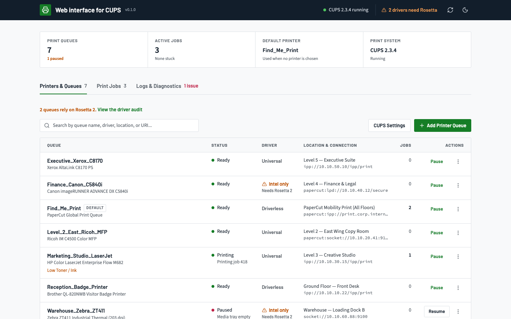

# CUPS webui

**Web interface for CUPS**: a modern, lightweight, single-binary replacement for the legacy CUPS web interface (`localhost:631`) on macOS.



Designed specifically to address UX barriers in macOS and UNIX environments:
- **Zero Configuration Access**: Bypasses the requirement to run `cupsctl WebInterface=yes` in Terminal.
- **Human-Centric UX**: Replaces technical abstractions (*PPDs*, *Classes*) with clear workflows (*Printers*, *Print Queues*, *Printer Pools*).
- **Modern Responsive Interface**: Clean dashboard that follows your Mac's light or dark appearance, built with Tailwind CSS and Lucide icons.
- **Queue Diagnostics & Stuck Job Remediation**: Identifies stuck print jobs and provides instant one-click cancellation.
- **Security-First**: Binds to loopback `127.0.0.1:6310` by default, and signs in only the macOS user who runs it. See [SECURITY.md](./SECURITY.md).

---

## One-Click Install (unofficial packaging)

This copy adds `Install CUPS WebUI.command` to the upstream project, [PaperCutSoftware/cups-web-interface](https://github.com/PaperCutSoftware/cups-web-interface). It is not published or supported by PaperCut. The PaperCut name and logo are trademarks of PaperCut Software.

1. Download the folder and keep its contents together.
2. Double-click `Install CUPS WebUI.command`.
3. macOS blocks the file the first time, because it came from the internet and is not notarized. Open **System Settings > Privacy & Security**, scroll to **Security**, and click **Open Anyway**. Then double-click the file again.
4. The installer clears the download flag on `bin/cups-webui`, installs the login service, and opens `http://127.0.0.1:6310`.

To skip step 3, clear the flag in Terminal before the first run:
```bash
xattr -dr com.apple.quarantine /path/to/the/folder
```

The file shows the PaperCut icon after its first run. Git and zip downloads do not keep Finder icons, so the installer puts the icon back from `assets/papercut-logo.png`.

To remove the service: `./bin/cups-webui launchagent uninstall`

---

## Quick Start

A pre-compiled universal binary for macOS (supporting both Apple Silicon and Intel) is included directly in [`bin/cups-webui`](./bin/cups-webui), so you can run the app immediately without installing Go or Node.js.

### 1. Launch the Web Interface
Start the server and automatically open the interface in your browser:
```bash
./bin/cups-webui -open
```
The interface will be available at `http://127.0.0.1:6310`. Once the server is running, you can open (or bookmark) that address directly; no login step is needed for the user account that runs the server. Other accounts on the same Mac are not signed in.

This runs until you close the Terminal window. To keep it running and start it at every login, see step 2.

### 2. Start Automatically at Login (Recommended)
Running the install command is all you need. It sets up cups-webui as a background service (a macOS LaunchAgent) that starts every time you log in and restarts if it stops. You don't need to enable anything else in the web interface.
```bash
# Install the service: it starts now and at every login
./bin/cups-webui launchagent install

# Or install it on a different port
./bin/cups-webui launchagent install -port 8631

# Check service status
./bin/cups-webui launchagent status

# Remove the service (it stops and no longer starts at login)
./bin/cups-webui launchagent uninstall
```

The install command copies the binary to `~/Library/Application Support/cups-webui/` and starts the service straight away. Open `http://127.0.0.1:6310` in your browser and bookmark it (or the port you chose with `-port`).

**Enable Auto-Start** under **CUPS Settings** in the web interface does the same thing, so use whichever is easier. It uses the port that instance is running on. Running `./bin/cups-webui -open` on its own (step 1) does not start it at login.

The service starts when you log in, not when the Mac boots, and only for your user account.

### 3. Run in Mock Mode (For Testing / Demo)
Runs with simulated printers, queues, and diagnostic alerts without requiring active printer hardware:
```bash
./bin/cups-webui -mock -open
```

---

## Setting Printer Accessories Manually

A driver usually detects a printer's accessories (trays, stapler, hole punch, duplexer) only when the queue is added, and some drivers ask the printer over SNMP. When the queue points at an IPP server such as PaperCut Mobility Print, the Mac can't reach the printer, so those accessories stay "not installed" and features like stapling are unavailable.

The **Hardware Accessories** tab lists the queue's installable options, installed ones first, and marks values that differ from the driver's default as *Detected* or *Set manually*. CUPS administrators can click **Edit accessories** (Advanced) to change them. Saving does the same as `lpadmin -p <queue> -o <Option>=<Choice>`: it updates only that queue's PPD, never the shared driver PPD. The app then reads the PPD back from CUPS and shows what was stored.

- These settings can't be checked against the printer. Confirm the printer has the hardware first. The warning is stronger when the queue doesn't point straight at the printer.
- The value itself is stored by CUPS in the queue's PPD. Who set it, when, and the value it replaced are notes kept by this app in `~/.cups-webui/accessory-overrides.json`. **Reset to detected values** puts the old values back.
- The notes belong to the macOS account running the service and stay on this Mac: another admin account, or a copy of the queue on another Mac, doesn't see them. "Set by" is that account's name, and the file can be edited by it, so treat the notes as a reminder, not an audit log. For a record of who changed a queue, see CUPS's own log (`/var/log/cups/access_log`).
- Notes are tied to the queue's CUPS identity (`printer-uuid`), so a queue deleted and re-created with the same name doesn't inherit them. Notes for deleted queues are removed. If the notes file is damaged or was written by a newer version of the app, the tab still shows the values from CUPS, but changes are refused until the file is fixed.
- If the queue's driver is replaced from the app, manual values are applied again.
- For drivers in a small built-in table (currently "Generic Universal Mono"), **Ask the device for suggestions** reads the device's IPP attributes and fills in the form. Nothing is saved until you confirm.
- The section isn't shown for driverless (AirPrint / IPP Everywhere) queues or for drivers without installable options.

---

## CLI Options

| Flag | Default | Description |
| :--- | :--- | :--- |
| `-port` | `6310` | Port to listen on |
| `-host` | `127.0.0.1` | Host interface to bind to. Only loopback is supported |
| `-mock` | `false` | Run with simulated CUPS mock data |
| `-open` | `false` | Automatically open default browser on launch |

Subcommands:
- `cups-webui open` – Open the running server in your default browser using its session link
- `cups-webui launchagent [install|uninstall|status]` – Manage the macOS background LaunchAgent service

---

## Building from Source

If you would like to build or modify the project yourself:

### Prerequisites
- [Go](https://go.dev/) (1.26+)
- [Node.js](https://nodejs.org/) (20+) and `npm`

The Go code uses only the standard library, so `go.mod` lists no dependencies and there is no `go.sum` file.

### Build Steps
```bash
# Build the frontend SPA and compile the universal macOS binary (bin/cups-webui):
make build

# Or compile only the native Go binary for your current machine architecture:
make build-go

# Or build the frontend independently:
cd web && npm install && npm run build
```

### Running Tests
Run the Go test suite:
```bash
make test
```

---

## Architecture

- **Backend (`cmd/cups-webui/main.go`, `internal/api/`, `internal/cups/`)**: Pure Go, standard library only, using `net/http` and the native CUPS command-line tools (`lpstat`, `lpadmin`, `lpoptions`, `cancel`, `cupsctl`, `cupsdisable`, `cupsenable`).
- **Frontend (`web/`)**: React 19 + TypeScript + Tailwind CSS v4 SPA, compiled directly into `internal/web/dist` and embedded into the Go binary with `go:embed`.
- **Packaging**: Single executable (`./bin/cups-webui`) with zero runtime dependencies.

---

## Security

The security model is described in [SECURITY.md](./SECURITY.md). Please report suspected vulnerabilities through <https://www.papercut.com/contact/security/> and not as public issues.

## License

MIT. See [LICENSE](./LICENSE). Bundled fonts are covered by their own licences; see [THIRD_PARTY_NOTICES.md](./THIRD_PARTY_NOTICES.md).

## About This Project

CUPS WebUI (`cups-webui`) is an open-source project actively maintained by [PaperCut Software](https://www.papercut.com/), makers of print management software. It was built after Apple decided to remove the built-in CUPS Web Interface (`localhost:631`) in macOS 27 Golden Gate. Although admins can still use commands like `lpadmin` and `lpstat` to manage print queues and default settings, `cups-webui` offers a much easier way to manage them.

